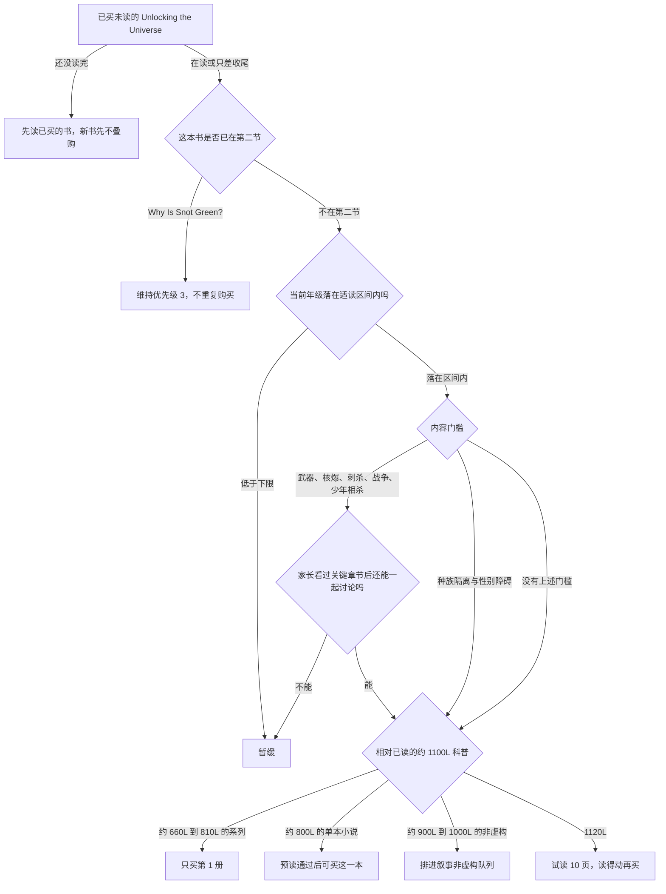

# 购书清单｜英文原版·科普 + 幽默（Kay's 读完后）

> **整理日期**：2026-08；**阅读进度更新**：2026-11  
> **目标读者**：英语母语，8–14 岁  
> **筛选标准**：幽默、有趣；蓝思 **800–1200L**；**非虚构科普**；出版商以 **英国或美国** 为主  
> **参照标杆**：已读完 Adam Kay 儿童线主干、Explodapedia 五册、*What If? 2*、*Immune*  
> **说明**：蓝思值带 `~` 者为估算；已核实官方值不加 `~`（如 Human Body Theater **GN920L**）。Scholastic 分册若有商品页官方 Lexile，括号注明。GN = Graphic Novel，图文分担信息，实际阅读负担通常低于同数字的纯文本。出版日期以**首版／常见英文原版**为准，改版年可能不同。  
> **数据附录**：各系列的分册明细、官方蓝思核查、内容与销量说明见 [`02-系列书目详细档案.md`](02-系列书目详细档案.md)

---

## 一、已读清单（不再列入待购）


| 书名                                                         | 作者       | 类型  | 蓝思值    | 出版时间    | 出版商（国别）    | 状态  |
| ---------------------------------------------------------- | -------- | --- | ------ | ------- | ---------- | --- |
| **Kay's Anatomy**                                          | Adam Kay | 科普  | 1060L  | 2020-10 | Puffin（英国） | 已读  |
| **Kay's Marvellous Medicine**                              | Adam Kay | 科普  | ~1050L | 2021-10 | Puffin（英国） | 已读  |
| **Kay's Incredible Inventions**                            | Adam Kay | 科普  | ~1050L | 2023-10 | Puffin（英国） | 已读  |
| **Dexter Procter the 10-Year-Old Doctor**                  | Adam Kay | 小说  | 910L   | 2024-09 | Puffin（英国） | 已读  |
| **Dexter Procter and the Case of the Disappearing Doctor** | Adam Kay | 小说  | —      | 2026    | Puffin（英国） | 已读  |
| **Explodapedia: The Cell** | Ben Martynoga | 科普 | ~900–1100L | 2023-04 | David Fickling（英国） | 已读 |
| **Explodapedia: The Gene** | Ben Martynoga | 科普 | ~900–1100L | 2023-04 | David Fickling（英国） | 已读 |
| **Explodapedia: Evolution** | Ben Martynoga | 科普 | ~900–1100L | 2023-11 | David Fickling（英国） | 已读 |
| **Explodapedia: The Brain** | Ben Martynoga | 科普 | ~900–1100L | 2025-01 | David Fickling（英国） | 已读 |
| **Explodapedia: Rewild** | Ben Martynoga | 科普 | ~900–1100L | 2024-05 | David Fickling（英国） | 已读 |
| **What If? 2** | Randall Munroe | 科普 | ~1150L | 2022-09 | Riverhead（美国） | 已读 |
| **Immune** | Philipp Dettmer | 科普 | ~1200L | 2021-11 | Random House（美国） | 已读 |


> 下一步原则：人体与生命科学长篇、以及 *What If? 2* 已经读完。*Unlocking the Universe* 已买、还没读，不再列入待购。还要买的是**换作者**和**科学通史**。人体复习书不再当作升级。*What If?* 第一部（2014）还没读，和续集内容独立，见「暂缓／可选」。Kay's Brilliant Brains 为 World Book Day 迷你本，见同一节。

**已购未读**

| 书名 | 作者 | 蓝思值 | 出版时间 | 出版商 | 状态 |
| --- | --- | --- | --- | --- | --- |
| **Unlocking the Universe** | Stephen Hawking／Lucy Hawking | ~1000L（全本估算；Penguin Readers 分级读本是另一本，官方 **1020L**） | 2020-01 | Puffin（英国） | 已购未读。书架上应是 Puffin 全本，约 448 页，不是 96 页的分级读本 |

---

## 二、下一批购买优先级总表（仅英美非虚构）


已读和已买的书移出后，下面只列还没买的。*Thing Explainer* 原本是给 *What If?* 铺路的，续集已经读完，所以降为可选。人体复习书排在科学通史和问答书后面。叙事非虚构与小说见第七节，不插入下面的 1–8 名。*Why Is Snot Green?* 只在本表买一次。


| 优先级 | 书名                                                          | 作者                            | 蓝思值                                                      | 出版时间               | 适龄    | 出版商（国别）                              | 幽默类型         | 一句话简介                                     |
| --- | ----------------------------------------------------------- | ----------------------------- | -------------------------------------------------------- | ------------------ | ----- | ------------------------------------ | ------------ | ----------------------------------------- |
| 1   | **Horrible Science: Blood, Bones and Body Bits**            | Nick Arnold／Tony De Saulles   | 约 840–900L 档（系列已核实分册多在 840–970L；*Evolve or Die* 达 1020L） | 1996（首版；其后多次改版）    | 8–14  | Scholastic（英国）                       | 英式恶心幽默       | 换作者的短章人体科普。Kay's、Explodapedia、Immune 都读过之后，用它换写法，再按需点物理／化学分册 |
| 2   | **A Short History of Nearly Everything**（Young Readers Ed.） | Bill Bryson                   | ~1050–1100L                                              | 2008（青少版；成人版 2003） | 12–14 | Delacorte / Penguin Random House（美国） | 英式自嘲讽刺       | 幽默科学通史。认准青少版，不要和 2003 年成人版混淆              |
| 3   | **Why Is Snot Green?**                                          | Glenn Murphy                  | **970L**（官方）                                           | 2007（英首版；美版 2009） | 8–12  | Macmillan Children's Books（英国）／Roaring Brook（美国） | 对话式趣味问答   | 伦敦科学博物馆问答。短章，可碎片读 |
| 4   | **Thing Explainer**                                         | Randall Munroe                | ~900–1000L                                               | 2015-11            | 10–14 | Houghton Mifflin Harcourt（美国）        | 极简极客         | *What If? 2* 已读。这本用常见词解释复杂事物，是换写法，不是更难的下一本 |
| 5   | **The Way We Work**                                         | David Macaulay                | ~1050L                                                   | 2008               | 10–14 | Houghton Mifflin / Roaring Brook（美国） | 含蓄冷幽默        | 手绘人体机制。人体长篇已读完，这本是看图巩固，不是升级              |
| 6   | **Human Body Theater**                                      | Maris Wicks                   | **GN920L**（官方）                                          | 2015-10            | 8–12／10–14 | First Second（美国）                     | 漫画舞台幽默       | 漫画复习 11 大系统。换形式，非难度升级 |
| 7   | **Grossology**（系列）                                          | Sylvia Branzei                | ~800–900L                                                | 1995 起（系列）         | 8–12  | Price Stern Sloan / Penguin（美国）      | 纯粹 Gross-out | 恶心科普零食。系列始于 1995，早于近 30 年这条线的起点          |
| 8   | **We Have No Idea**                                             | Jorge Cham／Daniel Whiteson   | **1110L**（官方）                                          | 2017-05              | 14+／高中–成人 | Riverhead / Penguin Random House（美国） | 漫画＋严肃科普   | 宇宙里还不知道什么。官方 1110L，留给高中，不作为 9–12 岁主读 |


**Explodapedia 五册（均已读，不必再买）**


| 分册          | 主题     | 出版时间    | ISBN（平装）      | 状态  |
| ----------- | ------ | ------- | ------------- | --- |
| *The Cell*  | 细胞     | 2023-04 | 9781788451918 | 已读  |
| *The Gene*  | 基因     | 2023-04 | 9781788452458 | 已读  |
| *Evolution* | 进化     | 2023-11 | 9781788452502 | 已读  |
| *The Brain* | 大脑     | 2025-01 | 9781788452748 | 已读  |
| *Rewild*    | 自然／再野化 | 2024-05 | 9781788452779 | 已读  |


**后续 Horrible Science 分册建议（同社、按需点菜，不必一次买齐）**：*Frightening Light*（1999）、*Sounds Dreadful*（1998）、*Fatal Forces*（1997）、*Shocking Electricity*（2000）、*Chemical Chaos*（1997）→ *Microscopic Monsters*（2001）、*Deadly Diseases*（2000）→ *Bulging Brains*（1999，870L）、*Evil Inventions*（2007，970L）、*Measly Medicine*（2006）。

---

## 三、分批采购建议

### 第一批（4 本，天文已买）


| #   | 书名                                               | 蓝思值         | 出版时间     | 出版商（国别） | 功能定位                   |
| --- | ------------------------------------------------ | ----------- | -------- | ------- | ---------------------- |
| 1   | **Horrible Science: Blood, Bones and Body Bits** | ~840–900L   | 1996（首版） | 英国      | 换作者；人体长篇已读完后的另一种写法 |
| 2   | **A Short History**（Young Readers Ed.）           | ~1050–1100L | 2008     | 美国      | 科学通史；认准青少版 |
| 3   | **Why Is Snot Green?**                           | **970L**    | 2007     | 英国／美国   | 幽默科学问答，尚未读 |
| 4   | **Thing Explainer**                              | ~900–1000L  | 2015-11  | 美国      | *What If? 2* 已读后的换写法，可选 |


### 第二批（复习向，非升级）


| #   | 书名                     | 蓝思值       | 出版时间    | 出版商（国别） | 功能定位                          |
| --- | ---------------------- | --------- | ------- | ------- | ----------------------------- |
| 5   | **The Way We Work**    | ~1050L    | 2008    | 美国      | 人体已覆盖后的手绘巩固，非升级               |
| 6   | **Human Body Theater** | **GN920L** | 2015-10 | 美国      | 漫画复习，非必需                      |
| 7   | **Grossology**         | ~800–900L | 1995 起  | 美国      | 恶心科普零食                        |
| 8   | **We Have No Idea**    | **1110L** | 2017-05 | 美国      | 14+／高中再读；不作为当前主读              |


---

## 四、蓝思值阶梯与阅读路径（自 800L 起）


| 层级  | 蓝思区间       | 对应书目                                                                                                           | 说明                |
| --- | ---------- | -------------------------------------------------------------------------------------------------------------- | ----------------- |
| 进阶  | 800–900L   | Grossology (~800–900L)、Horrible Science 多数分册                                                                   | 短章／恶心幽默，换作者巩固非虚构习惯 |
| 核心  | 900–1100L  | Human Body Theater (**GN920L**)、Why Is Snot Green? (**970L**)、Unlocking the Universe (~1000L，**已购未读**)、Thing Explainer (~900–1000L)、Explodapedia (~900–1100L，**已读**)、The Way We Work (~1050L)、Short History YR (~1050–1100L) | 问答和通史仍待买；天文书已在书架上 |
| 挑战  | 1100–1200L | We Have No Idea (**1110L**)、What If? 2 (~1150L，**已读**)、Immune (~1200L，**已读**)                                               | 这一档里还没读的是 *We Have No Idea*，留给高中 |


**推荐阅读顺序（2026-11 已读之后）**

```
Horrible Science（人体或物理 1–2 册，换作者；还没买）
  → Unlocking the Universe（已买，先读这本）
  → A Short History of Nearly Everything（青少版；还没买）
  → Why Is Snot Green?
  →（可选）Thing Explainer
  →（人体复习，非升级）The Way We Work / Human Body Theater / Grossology
  →（14+）We Have No Idea
```

**已经读完、不必再排进路径的**：Kay's 儿童线主干、Explodapedia 五册、*Immune*、*What If? 2*。

**已买、还没读**：*Unlocking the Universe*。先确认是 Puffin 全本，不是 Penguin Readers 分级读本。

**人体／生命线**：长篇已经闭环。剩下的 Horrible Science 人体分册、*The Way We Work*、*Human Body Theater*、Grossology 都是换写法或零食。

**物理／跨学科线**：*What If? 2* 已读。还可以读 Horrible Science 的光、声、力、电、化学分册，以及可选的 *Thing Explainer*。2014 年的 *What If?* 第一部内容独立，尚未读。

**天文／宇宙线**：*Unlocking the Universe* 已买、未读，是这条线的下一本。*We Have No Idea* 留到 14+。*Why Is Snot Green?* 里的太空章节可以先碎片读。

---

## 五、暂缓／可选（不进第一批）


| 书名                                            | 作者             | 蓝思值                | 出版时间    | 出版商（国别）                  | 备注                                         |
| --------------------------------------------- | -------------- | ------------------ | ------- | ------------------------ | ------------------------------------------ |
| **The Body: A Guide for Occupants**           | Bill Bryson    | ~1200L             | 2019-10 | Penguin Random House（英美） | 已标「太难」；14+／能力强再考虑                          |
| **Kay's Brilliant Brains**                    | Adam Kay       | 迷你本（负担远低于 Anatomy） | 2023-02 | Puffin（英国）               | 2023 世界读书日彩蛋：天才人物短篇，**非**大脑解剖升级            |
| **What If?**（第一部）                             | Randall Munroe | ~1150L             | 2014-09 | HMH（美国）                  | *What If? 2* 已读。第一部内容独立，尚未读，可后补          |
| **The Way Things Work Now**                   | David Macaulay | —                  | 2016    | HMH 系（美国）                | 讲「万物如何运作」，与人体专题 *The Way We Work*（2008）不同书 |
| **Kay's Anatomy: The Poo-tastic Puzzle Book** | Adam Kay       | 活动书（无蓝思）           | 2025-10 | Puffin（英国）               | 互动谜题本；巩固用，非系统科普                            |
| **How Loud Can You Burp?**                    | Glenn Murphy   | 未核官方蓝思（风格同 *Snot Green*） | 2008    | Macmillan Children's Books（英国） | *Why Is Snot Green?* 同系列续作；可先试读首册再决定是否续购 |
| **We Have No Idea**（若能力未到）               | Jorge Cham／Daniel Whiteson | **1110L** | 2017-05 | Riverhead（美国）            | 已列入待购最后一项；当前不作为 9–12 岁主读，延后到高中 |


---

## 六、明确不列入本清单


| 书名                                                  | 原因                         |
| --------------------------------------------------- | -------------------------- |
| The Last Kids on Earth                              | 蓝思约 570–650L（低于 800L），且为小说 |
| Diary of a Wimpy Kid / Dog Man / Magic School Bus 等 | 小说或蓝思偏低，或非本清单「仅非虚构科普」范围    |
| 已读五本 Adam Kay                                       | 见第一节                       |
| Explorer Academy、Spy School、The Wild Robot、Refugee、The Hunger Games | 小说。2026-11 记入第七节，不并入第二节 1–8 名 |


---

## 七、本次追加（2026-11）：叙事非虚构与小说

> 不改第二节 1–8 名。第二节仍是幽默科普，800–1200L。  
> *Why Is Snot Green?* 已在第二节第 3 位、第一批第 3 本，此处不重复购买。  
> 读者口径与全文相同：英语母语，约 10–11 岁，已读完约 1060L–1200L 科普。  
> 已购未读的 *Unlocking the Universe* 先读，下面的新书不叠在它前面。  
> 国际对标里 *Chasing Lincoln's Killer* 的 1010L、*Hidden Figures* 青少版的 1000L，以本节的 **980L**、**1120L** 为准。

### 九本合序

| 序 | 书名 | 作者 | 归入 | 排序依据 |
| --- | --- | --- | --- | --- |
| 1 | **Why Is Snot Green?** | Glenn Murphy | 已在第二节第 3 位 | 970L，幽默科普，8–12 岁，无暴力门槛。不重复购买 |
| 2 | **Bomb** | Steve Sheinkin | 叙事非虚构第 1 | 920L。先看武器与核爆后果，再给接近 11 岁的读者 |
| 3 | **Hidden Figures**（Young Readers' Edition） | Margot Lee Shetterly | 叙事非虚构第 2 | 1120L、ATOS 8.2，这批里句子最难，先试读 10 页 |
| 4 | **The Wild Robot** 第 1 册 | Peter Brown | 小说第 1 | 8–12 岁现在能读。740L 低于已读科普，电影只改编第 1 册 |
| 5 | **Refugee** | Alan Gratz | 小说第 2 | 800L 单本。战争、溺水和死亡先预读；通过后可与第 4 位对调 |
| 6 | **Spy School** 第 1 册 | Stuart Gibbs | 小说第 3 | 第 1 册才是 740L；第 1–9 册为 730L–860L。14 册只买第 1 册 |
| 7 | **Chasing Lincoln's Killer** | James L. Swanson | 叙事非虚构第 3 | 980L，11 岁起。刺杀、枪击和处决先预读 |
| 8 | **Explorer Academy** 第 1 册 | Trudi Trueit | 小说第 4 | 已核实 660L–700L，低于清单 800L 下限 |
| 9 | **The Hunger Games** | Suzanne Collins | 小说暂缓 | 第 1 册 810L 不构成新难度。约 12 岁并预读后再议 |

书名、系列册数、蓝思、适读年级、题材、推荐理由和影视备注见下面两张明细表。*Why Is Snot Green?* 的明细在第二节，问答系列首册，续作另计，无影视改编。

### 优先级矩阵

横轴是文本是否接上现在约 900L–1200L 的非虚构能力，纵轴是现在能否直接读。右上角先买。

|  | 现在就能读 | 先预读、试读，或等年级 |
| --- | --- | --- |
| **接上约 900L–1120L** | *Why Is Snot Green?*（已在第一批，不重复买） | *Bomb*（先看核武章节）；*Hidden Figures* 青少版（1120L，先试读）；*Chasing Lincoln's Killer*（11 岁起） |
| **约 660L–810L，补兴趣** | *The Wild Robot* 第 1 册；*Spy School* 第 1 册；*Explorer Academy* 第 1 册放最后 | *Refugee*（预读通过后可升为单本历史小说）；*The Hunger Games*（约 12 岁后再议） |

### 购书决策流程

年级、内容和难度按这个顺序判断。



| 书 | 流程出口 |
| --- | --- |
| *Why Is Snot Green?* | 已在第二节，不重复买 |
| *Bomb* | 预读后进入叙事非虚构第 1 |
| *Hidden Figures* 青少版 | 试读 10 页 |
| *The Wild Robot* | 只买第 1 册 |
| *Refugee* | 预读后可买这一本 |
| *Spy School* | 只买第 1 册 |
| *Chasing Lincoln's Killer* | 未满 11 岁暂缓；到了再预读 |
| *Explorer Academy* | 只买第 1 册，排在其他低蓝思小说之后 |
| *The Hunger Games* | 暂缓到约 12 岁，并先预读 |

### 叙事非虚构（单列，排在第一批幽默科普之后）

| 序 | 书名 | 作者 | 系列 / 册数 | 蓝思 | 适读 | 题材 | 推荐理由 | 备注 |
| --- | --- | --- | --- | --- | --- | --- | --- | --- |
| 1 | **Bomb** | Steve Sheinkin | 单本，2012 | **920L** | 6–8 年级，11–14 岁 | 科学史、二战、伦理 | 纽伯瑞荣誉、Sibert 金奖。原子弹竞赛的叙事非虚构，补科学通史旁边的事件叙事 | 含武器研发、间谍、核爆后果，先预读。无本书改编电影；《奥本海默》（2023，R）是另一部作品 |
| 2 | **Hidden Figures**（Young Readers' Edition） | Margot Lee Shetterly | 青少版单本，2016，约 240 页 | **1120L**，ATOS 8.2 | 兴趣年级 4–7 | 科学家传记、数学、航天、民权 | 四位 NASA 非裔女数学家。接已读科普 | 先试读 10 页。种族隔离与性别障碍宜一起讨论。2016 年电影 PG，改编自成人版 |
| 3 | **Chasing Lincoln's Killer** | James L. Swanson | 单本，2009；依据成人书 *Manhunt* | **980L**，ATOS 7.5 | 6–8 年级，11 岁起 | 叙事历史、一手材料 | 林肯遇刺后 12 天追捕。练非虚构里的悬念 | 含枪击、刺杀、处决及历史图像，先预读。无本书的院线改编 |

### 小说（应本次要求单列，不并入第二节）

| 序 | 书名 | 作者 | 系列 / 册数 | 蓝思 | 适读 | 题材 | 推荐理由 | 备注 |
| --- | --- | --- | --- | --- | --- | --- | --- | --- |
| 1 | **The Wild Robot** | Peter Brown | 小说 3 册。第 1 册 2016；第 2 册 *Escapes*；第 3 册 *Protects*（2023）。2025 年 *On the Island* 是图画书 | 第 1 册 **740L**；第 2 册 720L；第 3 册蓝思未核 | 3–7 年级，8–12 岁 | 科幻、生存、亲情 | 章节短的完整长篇，用来换口味 | 只买第 1 册。野外分离与动物死亡，程度适合这一年龄。2024 年梦工厂动画 PG，只改编第 1 册 |
| 2 | **Refugee** | Alan Gratz | 单本，2017 | **800L** | 5–8 年级，10–14 岁（本次指定 5–9 年级） | 历史小说、生存 | 1930 年代德国、1994 年古巴、2015 年叙利亚三条难民线 | 战争、溺水、离散、死亡，先预读。预读通过后可与 *Wild Robot* 对调。未见院线改编 |
| 3 | **Spy School** | Stuart Gibbs | 14 册；末册 *Spy School Goes East*（2026-10）。图像小说另计 | 第 1 册 **740L**。第 1–9 册 **730L–860L** | 出版社 8–12 岁、3–7 年级（本次指定 4–6 年级） | 幽默、间谍 | 幽默对得上兴趣 | 只买第 1 册。危险是卡通式的。未见已上映的院线改编 |
| 4 | **Explorer Academy** | Trudi Trueit | 主线 7 册，须按序。第 7 册后另有 *Vela* | 第 1 册 660L；第 2–3 册 690L；第 4 册 700L；第 5 册 670L。第 6–7 册官方蓝思未登录，ATOS 4.8 / 4.9 | 8–12 岁，约 3–7 年级 | 冒险、地理、科学装置、解谜 | 全球航线加书后真实科学说明 | 低于清单 800L 下限。只在需要轻松系列时买第 1 册。含母亲去世、行刺、溺水。未见院线改编 |
| 5 | **The Hunger Games** | Suzanne Collins | 主线 3 册；前传另有 2020、2025 两册 | 第 1 册 **810L**（后几册不是同一个数） | 6–9 年级 | 反乌托邦、生存 | 本次指定纳入；以内容年龄决定是否购买 | 当局强迫少年互相杀戮。约 12 岁并预读后再议。三部曲 4 部电影（2012–2015）及 2023 年前传电影均为 PG-13 |

**这一节的阅读顺序**

```
（第二节第一批不变）Horrible Science → Short History 青少版 → Why Is Snot Green?
  → Bomb（预读后）
  → Hidden Figures 青少版（试读 10 页）
  → The Wild Robot 第 1 册
  → Refugee（预读后）
  → Spy School 第 1 册
  →（11 岁起）Chasing Lincoln's Killer
  →（可选）Explorer Academy 第 1 册
  →（约 12 岁并预读）The Hunger Games
```

---

> 购买时认准 **Young Readers / 青少版**（如 Short History、Hidden Figures）、**英文原版 ISBN**，以及英美社版本（Scholastic UK、Puffin、David Fickling、Riverhead、Random House、HMH、First Second、Penguin 等）。Explodapedia 五册已读，不必再买。*Why Is Snot Green?* 只买一次，见第二节。

